# Remote for Roon 사용 설명서

[English](GUIDE.md) · **한국어**

Remote for Roon의 모든 기능과 각 설정의 의미, 그리고 더 잘 활용하는 방법을 정리했습니다. 처음이시라면 [설정하기](#setup)와 [존과 활성 존](#zones)만 먼저 읽으셔도 충분합니다. 나머지는 필요할 때 찾아보시면 됩니다.

플러그인의 메뉴와 설정 이름은 영어로 표시되므로, 이 설명서에서도 **굵은 영어**로 그대로 적었습니다.

**목차**

1. [설정하기](#setup)
2. [존과 활성 존](#zones)
3. [Scene](#scene): 버튼 하나로 시스템 전체를
4. [Play](#play): 키에 둔 라이브러리
5. [Album Roulette](#roulette)
6. [Up Next](#up-next)
7. [Sleep Timer](#sleep-timer)
8. [Now Playing](#now-playing)과 여러 키에 걸친 큰 커버
9. [Transport](#transport)
10. [Volume](#volume)
11. [Zone](#zone)
12. [Transfer](#transfer)와 [Group](#group)
13. [Power](#power)
14. [Roon Dial (Stream Deck +)](#dial)
15. [Roon이 허용하는 것과 허용하지 않는 것](#limits)
16. [페이지 구성 예시](#ideas)
17. [키에 표시되는 메시지](#messages)
18. [문제 해결](#troubleshooting)

---

## 설정하기

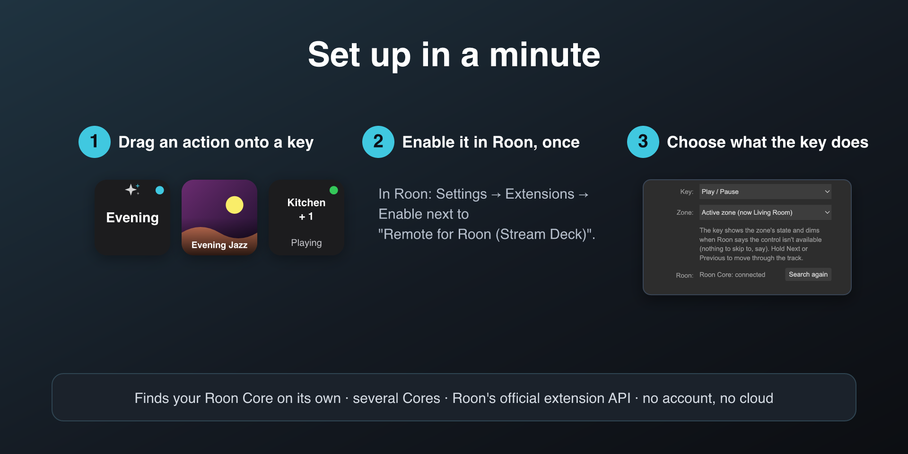

1. **Remote for Roon 동작을 키에 끌어다 놓습니다.** Stream Deck 앱 오른쪽 목록의 "Remote for Roon" 아래에 동작들이 있습니다. 처음에는 키에 **Enable in Roon**이 표시됩니다.
2. **Roon에서 한 번만 허용합니다.** Roon에서 **Settings → Extensions**를 열고 **"Remote for Roon (Stream Deck)"** (게시자 Artifex) 옆의 **Enable**을 누릅니다. 그러면 모든 키가 한꺼번에 작동하기 시작하며, 같은 Core에서는 다시 할 필요가 없습니다.
3. **키가 할 일을 고릅니다.** Stream Deck 앱에서 키를 누르면 설정 화면이 열립니다. 대부분의 키는 따로 설정하지 않아도 됩니다. 기본적으로 활성 존을 따라가기 때문입니다 (아래 설명).

**Roon Core 찾기.** 플러그인은 Roon 앱과 같은 방식으로 네트워크에서 Roon Core(Roon Server)를 스스로 찾습니다. 찾지 못하는 경우(다른 네트워크 대역, VPN, 방화벽 등)에는 키 설정 화면 맨 아래의 **Address**에 Core의 IP 주소를 입력하고 **Add**를 누르십시오. 예: `192.168.1.20` (포트는 보통 9330입니다). **Search again**을 누르면 다시 찾습니다.

**컴퓨터가 허용 여부를 물을 수 있습니다.** Stream Deck이 로컬 네트워크의 기기를 찾아도 되는지(macOS) 또는 방화벽을 통과해도 되는지(Windows) 물으면 **허용**을 선택하십시오.

**Roon Core가 여러 대라면** 각 Core에서 확장을 허용해 주십시오. 그러면 각 키의 설정 화면 맨 아래에 **Core** 메뉴가 생깁니다.

**사용하는 방식.** Roon의 공식 확장 API를 집 안 네트워크에서만 사용합니다. 로그인할 계정도 없고, 클라우드를 거치는 것도 없습니다.

---

## 존과 활성 존

Roon에서 **존(zone)**은 음악이 재생되는 곳입니다. Roon의 Settings → Audio에서 활성화한 오디오 기기에 직접 붙인 이름("Living Room")이거나, 함께 재생하도록 **그룹**으로 묶은 여러 존("Kitchen + Dining")입니다. Remote for Roon도 같은 용어를 씁니다.

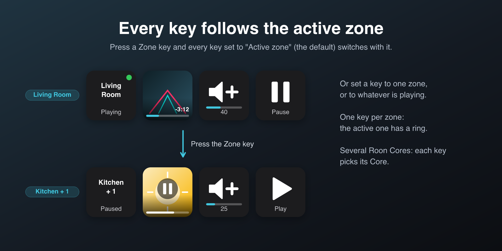

모든 키에는 **Zone** 메뉴가 있고, 세 가지 중에서 고를 수 있습니다.

| 선택 | 키가 제어하는 대상 |
|---|---|
| **Active zone** (기본값) | 지금 키들이 따라가는 존입니다. [Zone](#zone) 키, [Scene](#scene), [Transfer](#transfer) 키, [다이얼](#dial)이 정하며, 아직 정해지지 않았다면 지금 재생 중인 존입니다. 활성 존을 바꾸면 "Active zone"으로 설정된 모든 키가 함께 바뀝니다. |
| **Whatever is playing** | 항상 지금 재생 중인 존입니다. |
| **특정 존** (Bedroom, Kitchen 등) | 항상 그 존입니다. 나중에 그룹으로 묶여도 그룹 존 안에서 찾아가고, 그룹 존을 표시합니다. |

메뉴에서 그룹 존 안에 있는 존은 "Dining (grouped in Kitchen + Dining)"처럼 표시되고, 재생 중인 존에는 이름 뒤에 "· playing"이 붙습니다.

**팁:** 대부분의 키는 **Active zone**으로 두고 Zone 키를 하나 추가하십시오. 버튼 한 번으로 Stream Deck 전체가 다른 방으로 바뀝니다.

---

## Scene

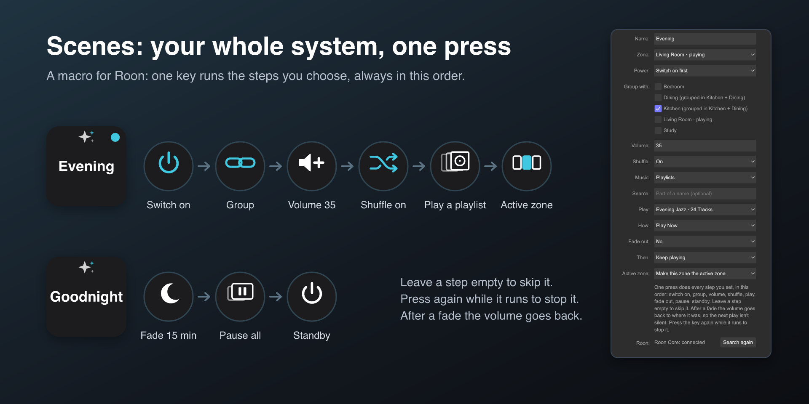

Scene은 Roon 시스템을 위한 매크로입니다. **버튼 하나로 여러 단계를 실행하며, 순서는 항상 다음과 같습니다.**

**켜기 → 그룹 → 볼륨 → 셔플 → 재생 → 페이드 아웃 → 일시정지 → 대기 모드 → 활성 존**

원하는 단계만 채우시면 되고, 비워 둔 단계는 건너뜁니다. 실행 중에는 키에 지금 단계("3/5 Volume")와 작은 파란 점이 표시되고, 끝나면 **Done**이 표시됩니다. **실행 중에 다시 누르면 멈추며**, 페이드 중이었다면 볼륨이 원래대로 돌아옵니다.

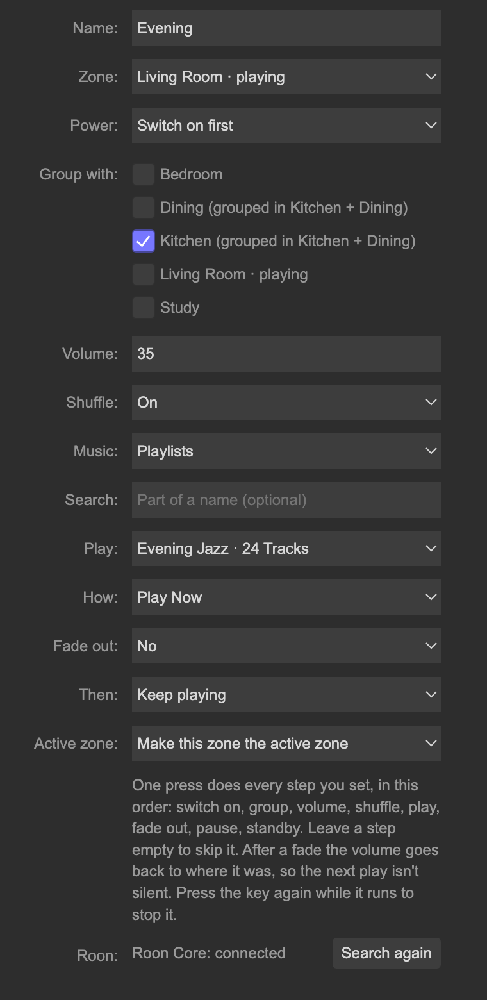

| 설정 | 하는 일 |
|---|---|
| **Name** | 키에 표시되는 이름입니다. 예: "Evening", "Goodnight", "Party". 비워 두면 "Scene"으로 표시됩니다. |
| **Zone** | Scene이 작동할 존입니다. **Active zone**(기본값) 또는 특정 존을 고릅니다. |
| **Power** | **Leave as it is**(그대로 두기), **Switch on first**(맨 먼저 앰프나 스트리머를 켜고 입력을 맞춤), **Standby at the end**(마지막에 대기 모드). Roon이 제어할 수 있는 오디오 기기에만 동작합니다. [Power](#power)를 참고하십시오. |
| **Group with** | 이 존에 합류해서 같은 음악을 재생할 존을 체크합니다. 아무것도 체크하지 않으면 그룹하지 않습니다. 존을 더하기만 하고, 기존 그룹을 풀지는 않습니다. Roon은 같은 종류의 존끼리만 묶을 수 있습니다 (AirPlay끼리, Chromecast끼리 등). |
| **Volume** | Roon에 표시되는 그 존의 단위로 적는 볼륨입니다. 0–100 기기라면 `35`, dB 기기라면 `-30`처럼 씁니다. 비워 두면 바꾸지 않습니다. 그룹 존에서는 다른 존들도 같은 단계만큼 움직이므로 균형이 유지됩니다. |
| **Shuffle** | **Leave as it is**, **On**, **Off**. |
| **Music, Search, Play, How** | 재생할 음악입니다. [Play](#play) 키와 똑같이 고릅니다. **Play: None**이면 아무것도 재생하지 않습니다. |
| **Fade out** | **10초, 30초, 1분, 5분, 15분**에 걸쳐 볼륨을 서서히 줄인 뒤 일시정지합니다. 그 후 볼륨이 원래대로 돌아오므로 다음에 재생할 때 소리가 작지 않습니다. |
| **Then** | **Keep playing**(계속 재생), **Pause this zone**(이 존 일시정지), **Pause every zone**(집 안의 모든 존 일시정지). |
| **Active zone** | **Make this zone the active zone**(기본값: 끝난 뒤 다른 키들이 방금 준비한 방을 제어) 또는 **Leave the active zone as it is**(그대로 두기). |

**예시**

- **Evening:** Zone Living Room · Power: Switch on first · Group with: Kitchen · Volume 35 · Shuffle On · Playlists → "Evening Jazz", Play Now.
- **Goodnight:** Zone: Active zone · Fade out: 15분 · Then: Pause every zone · Power: Standby at the end · Active zone: Leave as it is.
- **Party:** Group with: 모든 존 · Volume 50 · 장르에서 Start Radio.
- **아침 뉴스:** Zone Kitchen · Power: Switch on first · Internet radio → 좋아하는 방송국 · Volume 25.

단계를 원하는 순서로 직접 짜고 싶으시면, Stream Deck에 내장된 **Multi Action**을 쓰시면 됩니다. Remote for Roon 동작(Play, Volume, Transfer 등) 여러 개를 Multi Action 하나에 넣으면 차례로 실행됩니다.

---

## Play

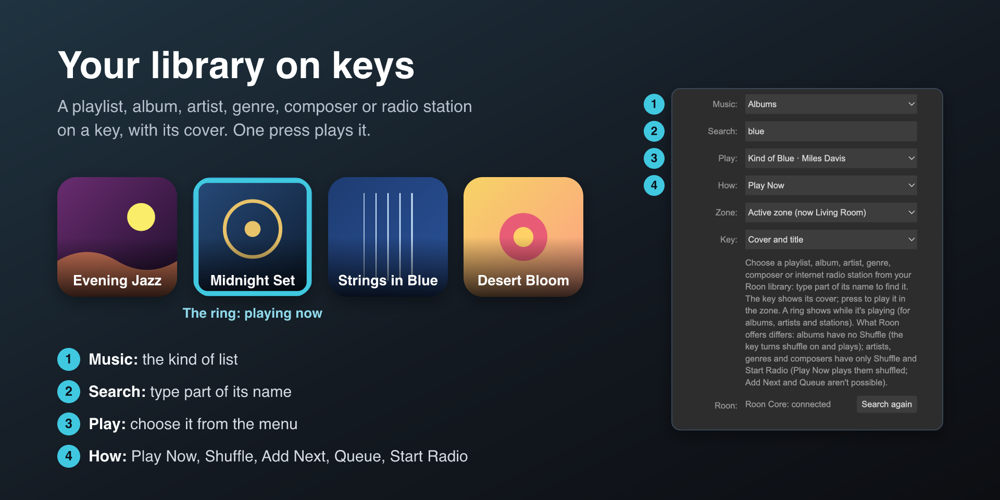

**Play** 키에는 Roon 라이브러리의 항목 하나(플레이리스트, 앨범, 아티스트, 장르, 작곡가, 인터넷 라디오 방송)를 담을 수 있고, 키에는 그 **커버**가 표시됩니다. 한 번 누르면 재생됩니다. 키에 테두리가 생기면 지금 재생 중이라는 뜻입니다 (Roon이 재생 중인 항목을 알려 주는 앨범, 아티스트, 방송의 경우).

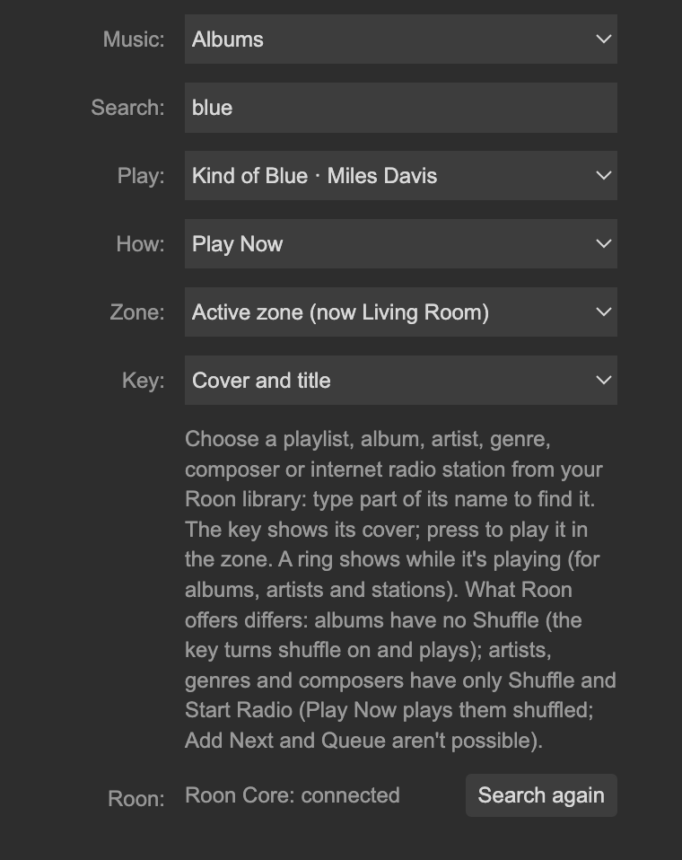

| 설정 | 하는 일 |
|---|---|
| **Music** | 고를 목록입니다: **Playlists, Albums, Artists, Genres, Composers, Internet radio**. |
| **Search** | 이름의 일부를 입력하면 **Play** 메뉴가 좁혀집니다. 예: "kind of"로 "Kind of Blue"를 찾습니다. 비워 두면 전체 목록이 Roon의 순서대로 나옵니다(최대 10,000개까지이며, 그보다 많으면 이름의 일부를 입력해 찾으십시오). 앨범, 아티스트, 작곡가는 Roon 자체 검색 결과가 먼저 나오고(작곡가나 연주자로도 앨범을 찾아 줍니다), 이어서 이름에 그 글자가 들어간 나머지 항목이 모두 나옵니다. |
| **Play** | 항목을 고릅니다. **None**은 아무것도 고르지 않은 상태입니다. 고른 항목은 다른 것을 검색해도 메뉴 맨 위에 "chosen"으로 남습니다. |
| **How** | Roon이 할 동작이며, Roon 자체 동작을 그대로 씁니다. **Play Now**(지금 재생 중인 것을 바꾸고 바로 재생), **Shuffle**(섞어서 재생), **Add Next**(지금 곡 다음에 추가), **Queue**(재생 대기열 끝에 추가), **Start Radio**(그 항목에서 Roon Radio 시작). |
| **Zone** | 재생할 곳입니다. 활성 존(기본값), 지금 재생 중인 존, 또는 특정 존. |
| **Key** | **Cover and title**(커버와 제목) 또는 **Cover only**(커버만). |

음악 종류마다 Roon이 제공하는 동작이 다릅니다. 자세한 내용은 [Roon이 허용하는 것](#limits)을 참고하십시오. 요약하면, 플레이리스트는 다섯 가지가 모두 되고, 앨범에는 Shuffle이 없으며(키가 셔플을 켠 뒤 재생합니다), 아티스트·장르·작곡가는 Shuffle과 Start Radio만 됩니다.

Roon은 재생 목록(queue)을 다 만든 뒤에 음악을 시작합니다. 앨범이 수천 장인 Classical처럼 큰 장르는 시간이 좀 걸릴 수 있습니다. 그동안 키에는 점이 움직이는 **Preparing**이 표시되고, Roon이 준비를 마치면 **Playing**으로 바뀝니다. 시간 제한은 없습니다. Roon과 연결되어 있는 한 키는 계속 기다리며, Roon이 응답하지 않게 되었을 때만 ⚠를 표시합니다. Album Roulette와 다이얼의 라이브러리 모드도 마찬가지입니다.

**팁:** 좋아하는 앨범과 플레이리스트를 Play 키로 한 줄 채우면 커버로 된 벽이 됩니다. 각각 한 번만 누르면 재생됩니다.

---

## Album Roulette

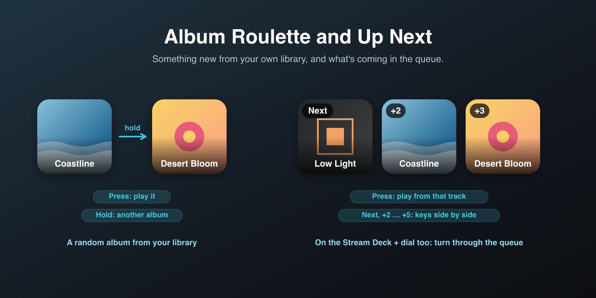

키에 **라이브러리에서 무작위로 고른 앨범**이 커버와 함께 표시됩니다.

- **누르기:** 그 앨범을 재생합니다 (**Press** 설정에 따라 다음 곡으로 추가하거나 대기열에 넣을 수도 있습니다).
- **길게 누르기:** 다른 앨범을 무작위로 보여 줍니다. 마음에 드는 앨범이 나올 때까지 길게 누르시면 됩니다.

다시 길게 누를 때까지, 그리고 다시 시작한 뒤에도 같은 앨범을 계속 보여 줍니다. 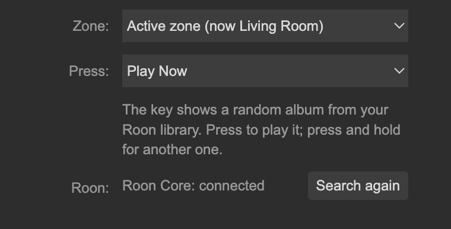

---

## Up Next

**Up Next** 키는 존의 재생 대기열에서 곧 나올 곡을 커버와 표시(**Next**, **+2**, **+3** … **+5**)와 함께 보여 줍니다.

- **누르기:** 그 곡부터 재생합니다 (그 앞의 곡들은 건너뜁니다).
- 다음 곡, +2, +3으로 설정한 키 세 개를 나란히 두면 앞으로 나올 곡들을 한눈에 볼 수 있습니다.

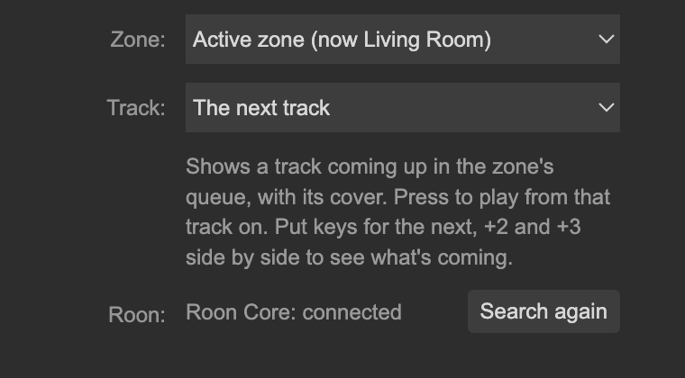

존이 멈춰 있으면 키에 **Not playing**이, 대기열이 끝나면 **End of queue**가 표시됩니다. [다이얼](#dial)에도 Up Next 모드가 있습니다.

---

## Sleep Timer

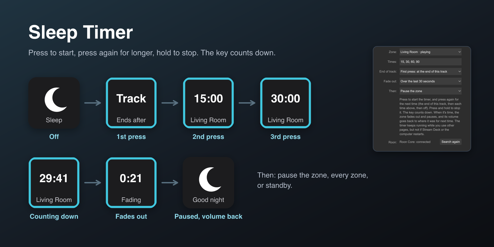

- **처음 누르기:** 지금 곡이 끝날 때 멈춥니다 (이 옵션을 켜 둔 경우).
- **더 누를 때마다:** 다음 시간으로 바뀝니다 (15, 30, 60, 90분 또는 직접 정한 시간). 마지막 다음은 **꺼짐**입니다.
- **길게 누르기:** 타이머를 멈춥니다.

키에 남은 시간(**29:41**)이 테두리와 함께 표시됩니다. 시간이 되면 존의 소리가 **서서히 줄어든 뒤 일시정지**하고(또는 모든 존이 일시정지하거나, 오디오 기기가 대기 모드로 들어갑니다), **볼륨은 다음을 위해 원래대로 돌아옵니다.** 키에는 **Good night**이 표시됩니다.

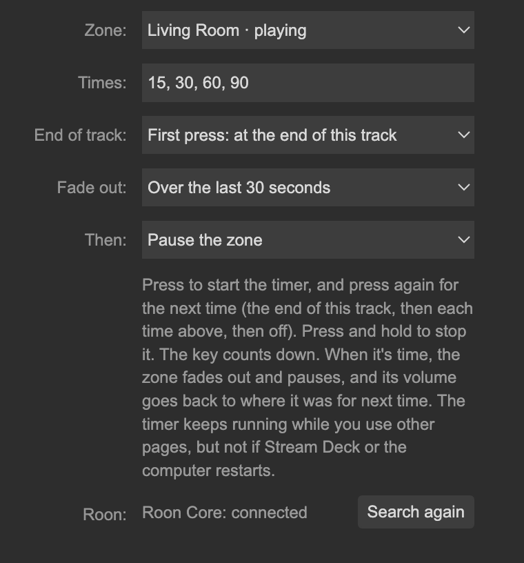

| 설정 | 하는 일 |
|---|---|
| **Zone** | 잠재울 존입니다. |
| **Times** | 누를 때마다 바뀌는 시간(분)을 쉼표로 구분해 적습니다. 기본값은 `15, 30, 60, 90`이고, `10, 20, 45`처럼 바꿀 수도 있습니다. |
| **End of track** | **First press: at the end of this track**(처음 누르면 지금 곡이 끝날 때) 또는 **Times only**(시간만). |
| **Fade out** | **No fade**(페이드 없음), 또는 마지막 **30초**, **2분**, **5분** 동안 서서히 줄이기. |
| **Then** | **Pause the zone**(존 일시정지), **Pause every zone**(모든 존 일시정지), **Pause, and standby the zone's audio devices**(일시정지 후 오디오 기기 대기 모드). |

다른 Stream Deck 페이지나 프로필을 쓰는 동안에도 타이머는 계속 돌아갑니다. 다만 Stream Deck이나 컴퓨터를 다시 시작하면 꺼집니다.

---

## Now Playing

존에서 재생 중인 곡의 앨범 아트를 진행 막대와 함께 보여 주고, 일시정지 중에는 일시정지 표시가 나옵니다 (원하시면 제목과 아티스트로 표시할 수도 있습니다).

| 설정 | 하는 일 |
|---|---|
| **Press** | **Play / Pause**, **Next track**(다음 곡), **Nothing**(아무 동작 안 함). |
| **Show** | **Album art**(앨범 아트) 또는 **Title and artist**(제목과 아티스트). |
| **Time** | 모서리에 표시할 시간: **None**(없음), **Time played**(재생한 시간), **Time left**(남은 시간), **Track length**(곡 길이). |
| **Size** | **One key**(키 하나) 또는 **여러 키에 걸친 큰 커버** (아래 설명). |

### 여러 키에 걸친 큰 커버

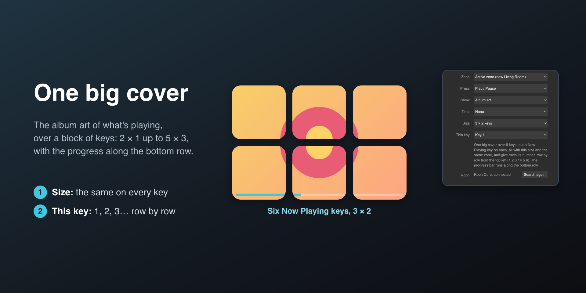

앨범 아트를 여러 키에 걸쳐 크게 보여 줍니다. 가로 2개 또는 3개, 또는 2 × 2, 3 × 2, 4 × 2, 3 × 3, 4 × 3, 5 × 3 키를 쓸 수 있습니다 (Stream Deck XL은 8 × 4입니다).

1. 큰 커버로 쓸 키마다 **Now Playing** 키를 놓습니다.
2. 모든 키의 **Size**와 **Zone**을 똑같이 설정합니다.
3. 각 키의 **This key**에 번호를 매깁니다. 왼쪽 위부터 한 줄씩 1, 2, 3… 순서입니다. 설정 화면에 고른 크기의 번호 배치가 표시됩니다.

진행 막대는 맨 아래 줄을 가로질러 표시됩니다. 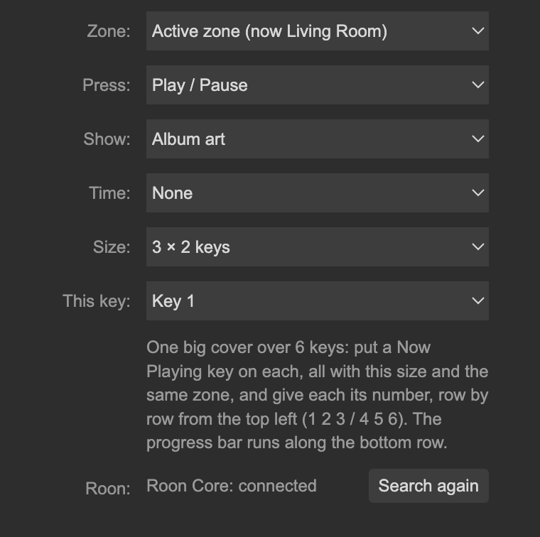

---

## Transport

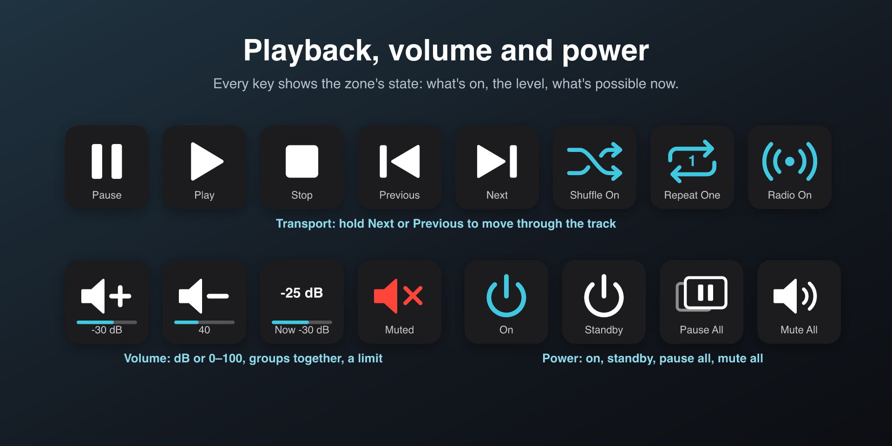

키 하나에 **Play / Pause**, **Play**, **Pause**, **Stop**, **Next**, **Previous**, **Shuffle on / off**, **Repeat: off, all, one**, **Roon Radio on / off** 중 하나를 지정합니다. 키에는 존의 상태(재생 중, 셔플 켜짐, 한 곡 반복 등)가 표시되고, Roon이 지금은 할 수 없다고 알려 주면(예: 건너뛸 다음 곡이 없을 때) 흐리게 표시됩니다.

**Next나 Previous를 길게 누르면** 곡을 건너뛰는 대신 곡 안에서 앞뒤로 이동합니다. 처음에는 10초씩, 누르고 있으면 점점 빠르게 이동합니다.

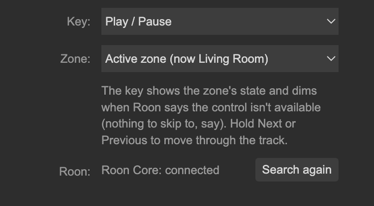

---

## Volume

| 키 | 하는 일 |
|---|---|
| **Volume up / down** | 한 번 누를 때마다 Roon이 그 존에 정한 한 단계씩(예: 0.5 dB 또는 1) 바뀝니다. **길게 누르면 계속** 바뀌고, 잠시 후에는 더 빨라집니다. |
| **Set to a level** | 정한 볼륨으로 바로 맞춥니다 (**Level**: dB는 `-25`, 0–100은 `40`처럼). 키에는 맞출 볼륨이 표시되고, 존이 그 볼륨이면 강조됩니다. |
| **Mute / unmute** | 볼륨 또는 Muted가 표시됩니다. |

| 설정 | 하는 일 |
|---|---|
| **Change** | **The zone and every zone grouped with it**(그 존과 함께 묶인 모든 존: 각자 자기 단계만큼 움직여 균형이 유지됩니다) 또는 **Only the zone chosen above**(위에서 고른 존만). |
| **Limit** | 선택 사항: 이 볼륨 위로는 올리지 않으므로, 키 때문에 소리가 너무 커질 일이 없습니다. 한계에 닿으면 키에 **Limit**이 표시됩니다. |

키에는 볼륨(dB 또는 0–100)이 막대와 함께 표시됩니다. 고정 볼륨 기기는 **Fixed**로 표시되고, Roon이 +와 −로만 제어하는 앰프(적외선 리모컨 방식 등)는 볼륨 숫자 없이 +와 −로 동작합니다. 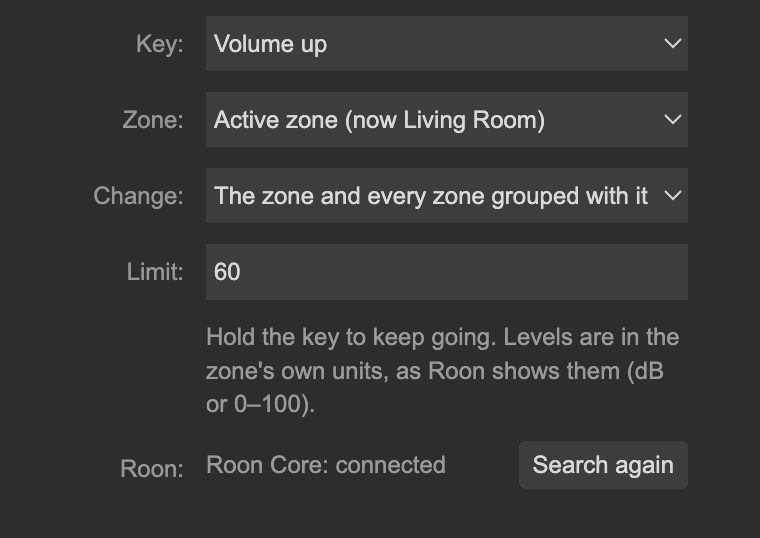

---

## Zone

| 키 | 하는 일 |
|---|---|
| **Switch the active zone** | 활성 존을 보여 주고, **누를 때마다 다음 존으로** 바꿉니다. 오갈 존을 체크할 수 있습니다 (아무것도 체크하지 않으면 모든 존). |
| **Make this zone active** | 존마다 키를 하나씩 나란히 둡니다. 누르면 그 존이 활성 존이 되고, 활성 존 키에는 테두리가 표시됩니다. |

**Active zone**으로 설정된 모든 키가 따라갑니다. 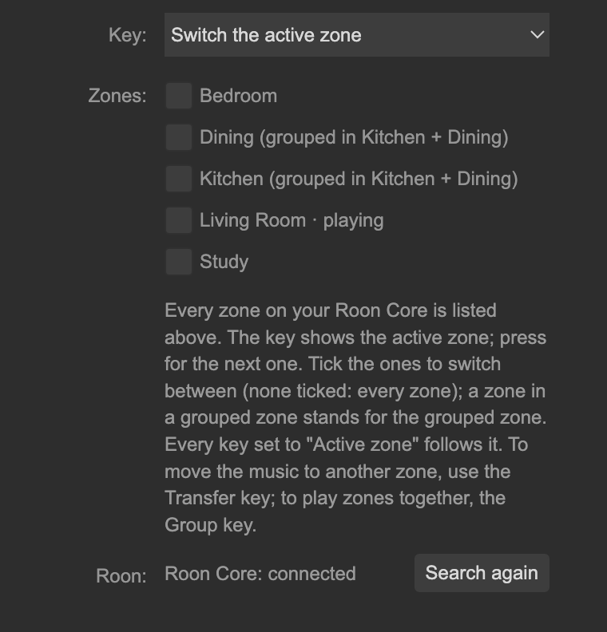

---

## Transfer

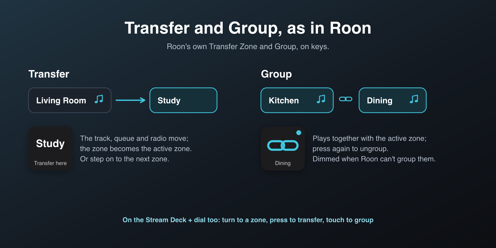

Roon의 **Transfer Zone** 기능입니다. 재생 중인 음악(곡, 재생 대기열, Roon Radio)을 다른 존으로 옮깁니다.

| 키 | 하는 일 |
|---|---|
| **Transfer to this zone** | 누르면 음악이 이 존으로 옮겨 오고, 이 존이 활성 존이 되어 테두리가 표시됩니다. 재생 중인 음악이 없으면 활성 존으로만 바뀝니다. |
| **Transfer to the next zone** | 활성 존을 보여 주고, 누를 때마다 음악을 다음 존으로 옮깁니다 (오갈 존을 체크할 수 있습니다). |

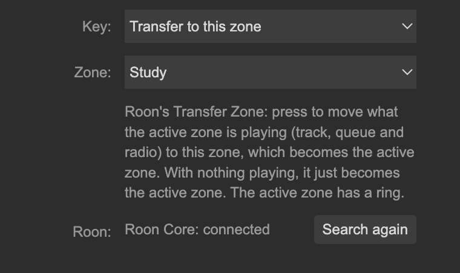

## Group

Roon의 **Group** 기능입니다. 누르면 이 키의 존을 활성 존과 그룹으로 묶어 같은 음악을 동시에 재생하고, 다시 누르면 **그룹을 풉니다.** 그룹으로 묶인 동안 키가 강조되고, Roon이 두 존을 묶을 수 없으면 흐리게 표시됩니다 (같은 종류의 존끼리만 묶을 수 있습니다). 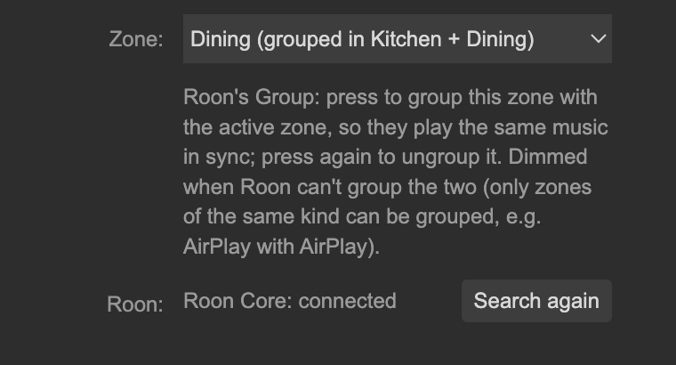

---

## Power

| 키 | 하는 일 |
|---|---|
| **On / standby** | 존의 앰프나 DAC를 **켜고**(올바른 입력으로 맞춤) 또는 **대기 모드**로 둡니다. |
| **Pause every zone** | 집 안 전체를 일시정지합니다. |
| **Mute / unmute every zone** | 다시 누르면 음소거가 풀립니다. |

**On / standby는 Roon이 제어할 수 있는 오디오 기기에서만 동작합니다.** Roon에서 **Settings → Audio →** 해당 기기의 설정(**Device Setup**) → **Standby**와 **Convenience switch**를 확인하십시오. 많은 네트워크 스피커(Chromecast, Nest, AirPlay 스피커 등)는 이 기능을 제공하지 않으며, 그때는 키에 **No control**이 표시됩니다. 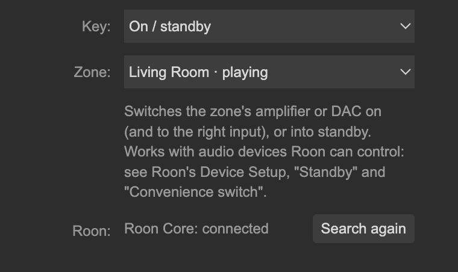

---

## Roon Dial (Stream Deck +)

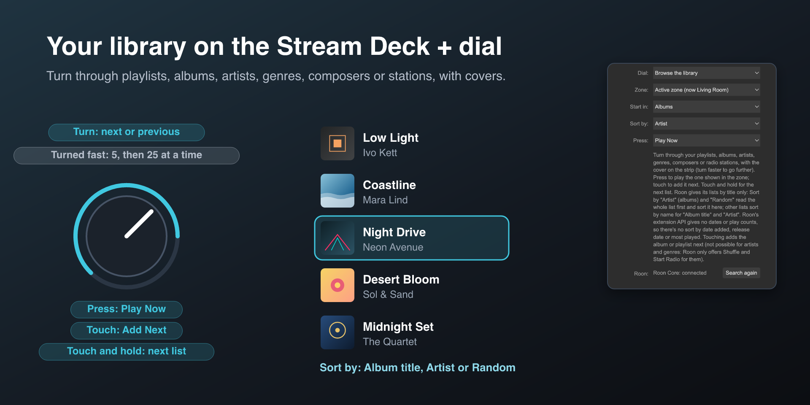

Stream Deck + 다이얼에 **Roon Dial**을 놓고 할 일을 고릅니다. 다이얼 위의 터치 스트립에는 커버, 제목, 막대가 표시됩니다.

| 다이얼 | 돌리기 | 누르기 | 터치 | 길게 터치 |
|---|---|---|---|---|
| **Volume** | 볼륨 (클릭당 1, 2, 5단계; 상한 설정 가능) | 음소거 | 재생 / 일시정지 | |
| **Move through the track** | 이동할 위치가 먼저 표시되고, 돌리기를 멈추면 Roon이 그 위치로 이동 (클릭당 5, 10, 30, 60초) | 재생 / 일시정지 | 다음 곡 | 이전 곡 |
| **Previous / next track** | 클릭당 한 곡 | 재생 / 일시정지 | 셔플 켜기 / 끄기 | 반복 모드 바꾸기 |
| **Pick the active zone** | 존 목록 넘기기 | 활성 존으로 지정 | 누르기와 같음 | 활성 존 표시로 돌아가기 |
| **Transfer the music to a zone** | 존 목록 넘기기 | 그 존으로 음악 옮기기 | 활성 존과 그룹 / 그룹 해제 | 활성 존 표시로 돌아가기 |
| **Browse the library** | 플레이리스트, 앨범, 아티스트, 장르, 작곡가, 방송 넘기기. 빨리 돌리면 5개씩, 그다음 25개씩 이동 | Play Now (**Press** 설정으로 Shuffle, Queue, Start Radio도 가능) | Add Next | 다음 목록 (Playlists → Albums → Artists → Genres → Composers → Internet radio) |
| **Up next (the queue)** | 앞으로 나올 곡 넘기기 | 그 곡부터 재생 | 다음 곡 | 바로 다음 곡 표시로 돌아가기 |

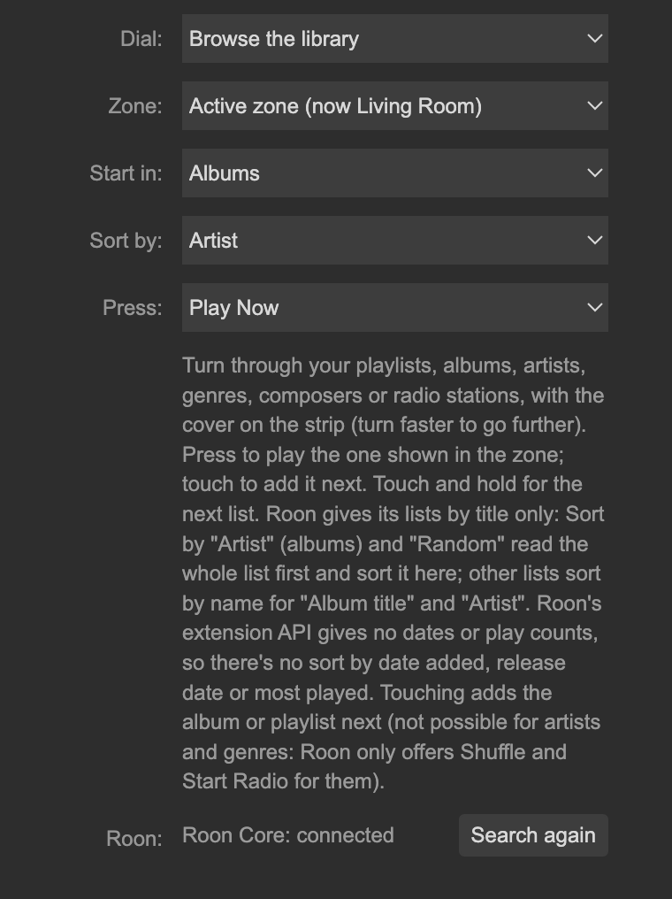

**Browse the library의 Sort by**는 Roon 앱의 정렬 메뉴와 같은 이름입니다. **Album title**(Roon의 기본 순서), **Artist**(아티스트별, 그 안에서 제목순), **Random**(무작위). Artist와 Random은 목록 전체를 한 번 읽어서 정렬하는데, 앨범이 수천 개여도 처음 한 번만 잠깐 걸립니다. Roon 앱의 다른 정렬(추가한 날짜, 발매일, 많이 재생한 순)은 할 수 없습니다. 이유는 아래에 있습니다.

---

## Roon이 허용하는 것과 허용하지 않는 것

Remote for Roon은 Roon의 **공식 확장 API**만 사용하므로 Roon이 업데이트되어도 고장 나지 않습니다. 다만 이 API는 Roon 앱 자체보다 할 수 있는 일이 적습니다.

- **음악 종류별 동작** (실제 Roon Core에서 확인했습니다): 플레이리스트는 **Play Now, Shuffle, Add Next, Queue, Start Radio**가 모두 됩니다. 앨범은 **Shuffle**만 없습니다 (플러그인이 셔플을 켠 뒤 재생합니다). 아티스트, 장르, 작곡가는 **Shuffle**과 **Start Radio**만 됩니다 (Play Now는 셔플로 재생하고, Add Next와 Queue는 **Not possible**로 표시됩니다).
- **정렬:** API는 목록을 제목순 한 가지로만 보내 주고, 날짜나 재생 횟수 정보가 없습니다. 그래서 다이얼은 앨범 제목순, 아티스트순, 무작위로는 정렬할 수 있지만, 추가한 날짜순, 발매일순, 많이 재생한 순은 할 수 없습니다.
- **API에 아예 없는 기능:** 하트와 즐겨찾기, 라이브러리에 추가, 플레이리스트나 재생 대기열 편집, Roon의 DSP와 EQ 설정, 가사, 신호 경로. 일부 무료 플러그인은 Roon의 비공개 프로토콜로 이런 기능을 쓰지만, Roon 업데이트 때 고장 날 수 있습니다. Remote for Roon은 그런 방식을 쓰지 않습니다.

---

## 페이지 구성 예시

- **방 하나를 위한 페이지 (모든 Stream Deck):** Zone 키, Now Playing, Play / Pause, Previous, Next, Volume down, Volume up, Mute, Up Next 키, Sleep Timer. 모든 키가 활성 존을 따라가므로 페이지 하나로 모든 방을 제어할 수 있습니다.
- **즐겨찾기 페이지:** 좋아하는 앨범과 플레이리스트로 채운 Play 키들, Album Roulette 키 하나, Scene 한두 개.
- **집 전체 페이지:** 방마다 "Make this zone active" 키 하나씩, Transfer 키, Group 키, Pause every zone, Mute every zone.
- **Stream Deck +:** 다이얼 1은 Volume, 다이얼 2는 Browse the library (Albums, Sort by Artist), 다이얼 3은 Up next, 다이얼 4는 Pick the active zone. 위쪽 키에는 Scene들.
- **Stream Deck XL:** 왼쪽에 4 × 3 큰 커버, 오른쪽에 제어 키들.

---

## 키에 표시되는 메시지

| 메시지 | 의미 |
|---|---|
| **Enable in Roon** | Roon에서 아직 확장을 허용하지 않았습니다. Settings → Extensions → Enable을 누르십시오. |
| **Connecting** / **No Core** | Roon Core를 찾는 중입니다. 계속 이 상태라면 [문제 해결](#troubleshooting)을 참고하십시오. |
| **Core off** | Roon Core가 응답하지 않습니다. Core가 돌아오면 키도 저절로 돌아옵니다. |
| **Zone off** | 키의 존을 지금 쓸 수 없습니다 (기기가 꺼져 있거나 Roon에서 비활성화됨). |
| **No zones** | Roon에 활성화된 존이 없습니다 (Settings → Audio). |
| **Pick a zone** / **Pick music** | 키에 존이나 재생할 음악이 필요합니다. 설정 화면에서 골라 주십시오. |
| **Not possible** | Roon이 여기서는 할 수 없는 동작입니다 (아티스트에 Queue, 대기 모드가 없는 기기의 standby, 고정 볼륨 기기 등). |
| **Not found** | 고른 음악이 더 이상 라이브러리에 없습니다 (이름이 바뀌었거나 삭제됨). 다시 골라 주십시오. |
| **Can't play** | Roon이 재생을 거부했습니다. |
| **Fixed** | 존의 볼륨이 고정되어 있습니다. |
| **Limit** | 볼륨 키의 상한에 닿았습니다. |
| **No control** | Power: Roon이 이 기기를 켜고 끌 수 없습니다 ([Power](#power) 참고). |
| **Can't group** | Roon이 두 존을 그룹으로 묶을 수 없습니다. |
| **Not now** | 지금은 할 수 없습니다 (예: 건너뛸 다음 곡이 없음). |

---

## 문제 해결

- **키에 "Enable in Roon"이 표시됩니다:** Roon에서 Settings → Extensions를 열고 "Remote for Roon (Stream Deck)" 옆의 Enable을 누르십시오.
- **"No Core"나 "Connecting"이 오래 계속됩니다:** Roon(또는 Roon Server)이 실행 중이고 이 컴퓨터와 같은 네트워크에 있는지 확인하십시오. 키 설정 화면에서 **Search again**을 누르거나, **Address**에 Core의 IP 주소를 입력하고 **Add**를 누르십시오. Mac에서는 시스템 설정 → 개인정보 보호 및 보안 → 로컬 네트워크에서 Stream Deck이 켜져 있는지 확인하십시오.
- **메뉴에 존이 보이지 않습니다:** Roon은 Settings → Audio에서 활성화한 오디오 기기만 보여 줍니다.
- **Power에 "No control"이 표시됩니다:** Roon의 Device Setup에 그 기기의 standby나 convenience switch 설정이 없습니다.
- **Group이 흐리게 표시됩니다:** Roon이 그 두 종류의 기기를 묶을 수 없습니다.
- **Sleep Timer가 멈췄습니다:** Stream Deck이나 컴퓨터를 다시 시작하면 타이머가 꺼집니다. 다시 시작해 주십시오.
- **키 설정 화면의 메뉴가 비어 있습니다:** Roon Core가 연결되어 있는지 확인하시고(설정 화면 맨 아래에 "connected"로 표시), 설정 화면을 닫았다가 다시 여십시오.

그래도 해결되지 않으면 [버그를 신고해 주십시오](../../../issues/new?template=bug_report.yml). 아래 위치의 최신 로그를 첨부해 주시면 도움이 됩니다.

- **macOS:** `~/Library/Application Support/com.elgato.StreamDeck/Plugins/com.johnlee.roonremote.sdPlugin/logs/`
- **Windows:** `%APPDATA%\Elgato\StreamDeck\Plugins\com.johnlee.roonremote.sdPlugin\logs\`

로그에는 Roon의 토큰이 절대 포함되지 않습니다.

---

Roon은 Roon Labs LLC의 상표입니다. Remote for Roon은 Roon Labs LLC와 제휴하거나 후원 또는 보증을 받지 않았습니다. 그 밖의 이름은 각 소유자의 상표입니다.
