# Remote for Roon: user guide

**English** · [한국어](GUIDE.ko.md)

Everything Remote for Roon does, what each setting means, and how to get the most out of it. For a quick start, read [Setting up](#setting-up) and [Zones and the active zone](#zones-and-the-active-zone); the rest you can look up when you need it.

**Contents**

1. [Setting up](#setting-up)
2. [Zones and the active zone](#zones-and-the-active-zone)
3. [Scene](#scene): your whole system, one press
4. [Play](#play): your library on keys
5. [Album Roulette](#album-roulette)
6. [Up Next](#up-next)
7. [Sleep Timer](#sleep-timer)
8. [Now Playing](#now-playing), and one big cover over several keys
9. [Transport](#transport)
10. [Volume](#volume)
11. [Zone](#zone)
12. [Transfer](#transfer) and [Group](#group)
13. [Power](#power)
14. [Roon Dial (Stream Deck +)](#roon-dial-stream-deck-)
15. [What Roon allows, and what it doesn't](#what-roon-allows-and-what-it-doesnt)
16. [Ideas: pages that work well](#ideas-pages-that-work-well)
17. [Messages on the keys](#messages-on-the-keys)
18. [Troubleshooting](#troubleshooting)

---

## Setting up

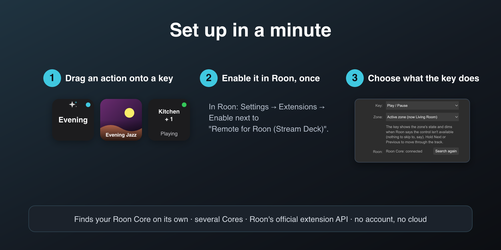

1. **Drag a Remote for Roon action onto a key** in the Stream Deck app (the actions are under "Remote for Roon" in the list on the right). The key says **Enable in Roon** at first.
2. **Enable it in Roon, once.** In Roon, open **Settings → Extensions** and click **Enable** next to **"Remote for Roon (Stream Deck)"** (published by Artifex). Every key comes alive at once; you never do this again on that Core.
3. **Choose what the key does** in its settings (click the key in the Stream Deck app). Most keys need nothing more: they follow the active zone (below).

**Finding your Roon Core.** The plugin finds your Roon Core (Roon Server) on your network by itself, the same way Roon's own apps do. If it doesn't (a different network segment, a VPN, a firewall), type the Core's IP address in **Address** at the bottom of any key's settings and click **Add**, for example `192.168.1.20` (the port is usually 9330). **Search again** looks once more.

**Your computer may ask** whether Stream Deck may find devices on your local network (macOS) or through the firewall (Windows): choose **Allow**.

**More than one Roon Core?** Enable the extension on each one. Each key then has a **Core** menu at the bottom of its settings.

**What it uses.** Roon's official extension API, on your own network. There's no account to sign in to and nothing goes through the cloud.

---

## Zones and the active zone

In Roon, a **zone** is where music plays: an audio device you've enabled in Roon (Settings → Audio), named by you ("Living Room"), or several zones **grouped** to play together ("Kitchen + Dining"). Remote for Roon uses the same words.

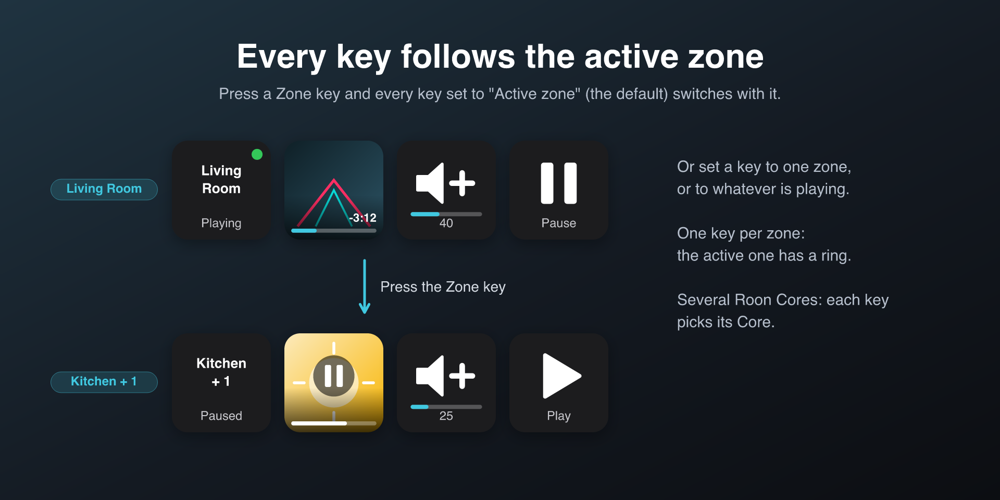

Every key has a **Zone** menu with three kinds of choice:

| Choice | What the key controls |
|---|---|
| **Active zone** (the default) | The zone your keys are following now. A [Zone](#zone) key, a [Scene](#scene), a [Transfer](#transfer) key or the [dial](#roon-dial-stream-deck-) picks it; until something has, it's whatever is playing. Switch it, and every key set to "Active zone" switches with it. |
| **Whatever is playing** | Always the zone that's playing right now. |
| **A zone** (Bedroom, Kitchen…) | Always that zone. If it's grouped later, the key finds it inside the grouped zone and shows the grouped zone. |

In the menu, a zone that's inside a grouped zone shows as "Dining (grouped in Kitchen + Dining)", and one that's playing has "· playing" after its name.

**Tip:** leave most keys on **Active zone** and add one Zone key: one press moves your whole Stream Deck to another room.

---

## Scene

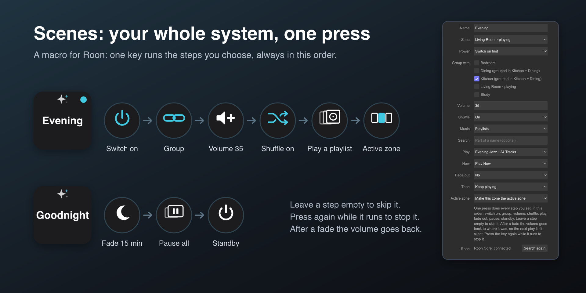

A Scene is a macro for your Roon system: **one press runs a set of steps, always in this order**:

**switch on → group → volume → shuffle → play → fade out → pause → standby → active zone**

You fill in the steps you want; any step left empty is skipped. While it runs, the key shows the step ("3/5 Volume") and a small blue dot; when it's done it says **Done**. **Press it again while it runs to stop it**: a fade stops and the volume goes back.

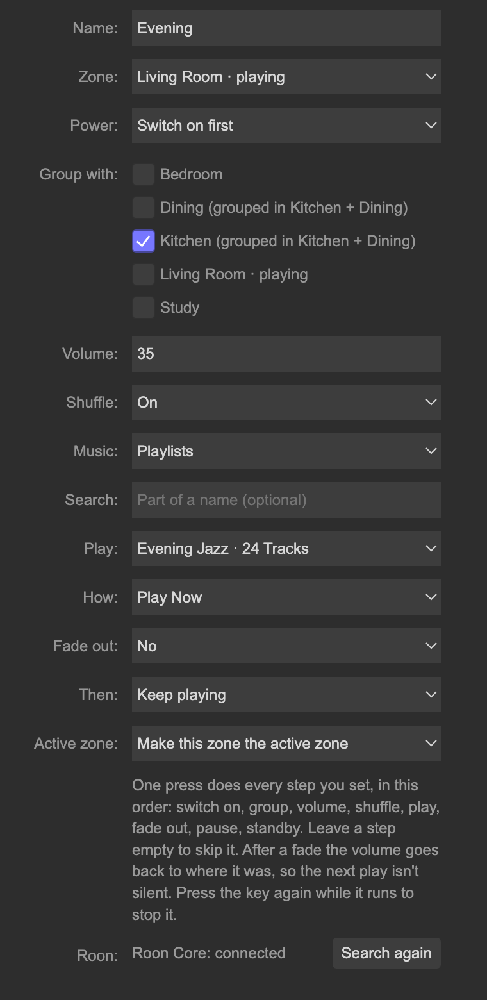

| Setting | What it does |
|---|---|
| **Name** | The word on the key: "Evening", "Goodnight", "Party". Empty: the key says "Scene". |
| **Zone** | The zone the scene works on. **Active zone** (the default) or a particular zone. |
| **Power** | **Leave as it is**, **Switch on first** (wakes the amplifier or streamer and selects its input before anything else), or **Standby at the end**. Only for audio devices Roon can control: see [Power](#power). |
| **Group with** | Tick the zones that should join this one and play the same music. Nothing ticked: no grouping. It only adds zones; it never splits groups. Roon only groups zones of the same kind (AirPlay with AirPlay, Chromecast with Chromecast…). |
| **Volume** | A level in the zone's own units, as Roon shows them: `35` for a 0–100 device, `-30` for a dB device. Empty: unchanged. In a grouped zone the other zones move by the same number of steps, so their balance stays. |
| **Shuffle** | **Leave as it is**, **On** or **Off**. |
| **Music, Search, Play, How** | Something to play, chosen exactly as on a [Play](#play) key. **Play: None** plays nothing. |
| **Fade out** | Lowers the volume step by step **over 10 seconds, 30 seconds, 1, 5 or 15 minutes, then pauses**; afterwards the volume goes back to where it was, so the next play isn't silent. |
| **Then** | **Keep playing**, **Pause this zone**, or **Pause every zone** (the whole house). |
| **Active zone** | **Make this zone the active zone** (the default: afterwards your other keys control the room you just set up), or **Leave the active zone as it is**. |

**Examples**

- **Evening:** Zone Living Room · Power: Switch on first · Group with: Kitchen · Volume 35 · Shuffle On · Playlists → "Evening Jazz", Play Now.
- **Goodnight:** Zone: Active zone · Fade out over 15 minutes · Then: Pause every zone · Power: Standby at the end · Active zone: Leave as it is.
- **Party:** Group with: every zone · Volume 50 · Start Radio from a genre.
- **Morning news:** Zone Kitchen · Power: Switch on first · Internet radio → your station · Volume 25.

Want your own steps in your own order? Stream Deck's built-in **Multi Action** runs several keys one after another: put Remote for Roon actions (Play, Volume, Transfer…) inside one.

---

## Play

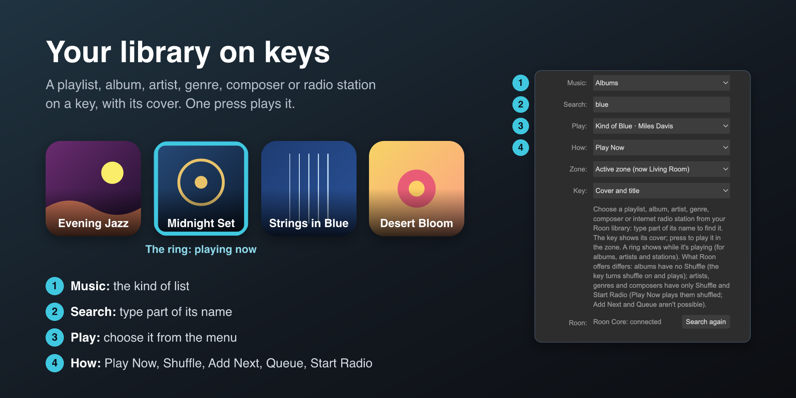

A **Play** key holds one thing from your Roon library (a playlist, album, artist, genre, composer or internet radio station) and shows its **cover**. One press plays it. A ring around the key means it's playing now (for albums, artists and stations, where Roon tells what's playing).

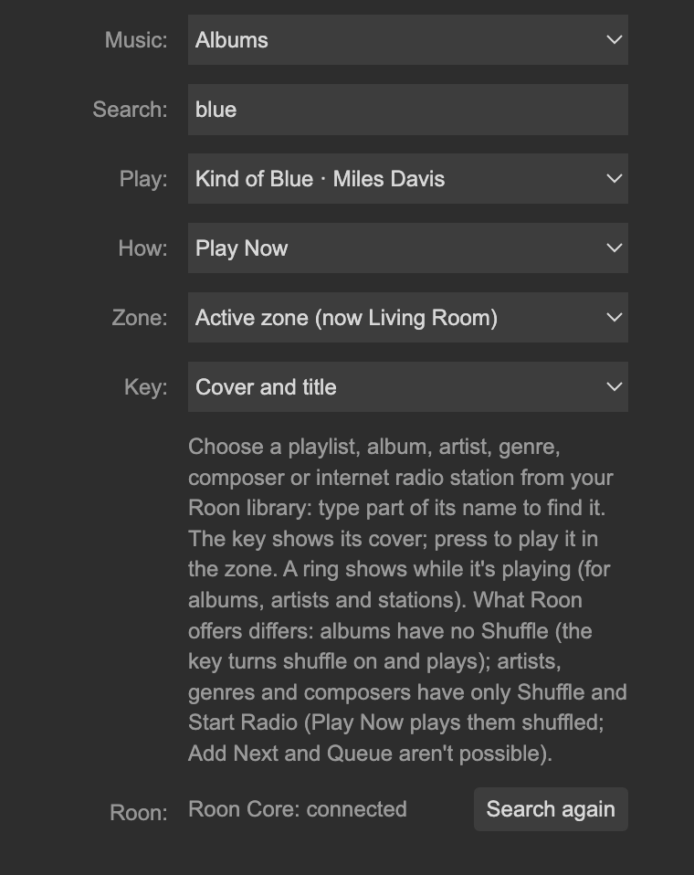

| Setting | What it does |
|---|---|
| **Music** | Which list to choose from: **Playlists, Albums, Artists, Genres, Composers, Internet radio**. |
| **Search** | Type part of a name to narrow the **Play** menu: "kind of" finds "Kind of Blue". Empty: the menu shows the first ones in the list. For albums, artists and composers it uses Roon's own search, so even a big library answers quickly. |
| **Play** | Choose the item. **None**: nothing chosen. Your choice stays at the top of the menu (marked "chosen") even after you search for something else. |
| **How** | What Roon does, with Roon's own actions: **Play Now** (replace what's playing and start), **Shuffle**, **Add Next** (after the current track), **Queue** (at the end), **Start Radio** (Roon Radio from it). |
| **Zone** | Where it plays: the active zone (default), whatever is playing, or a zone. |
| **Key** | **Cover and title**, or **Cover only**. |

Roon offers different actions for different kinds of music; see [What Roon allows](#what-roon-allows-and-what-it-doesnt). In short: playlists have all five; albums have no Shuffle (the key turns shuffle on and plays); artists, genres and composers have only Shuffle and Start Radio.

**Tip:** a row of Play keys with your favourite albums and playlists makes a wall of covers; one press each.

---

## Album Roulette

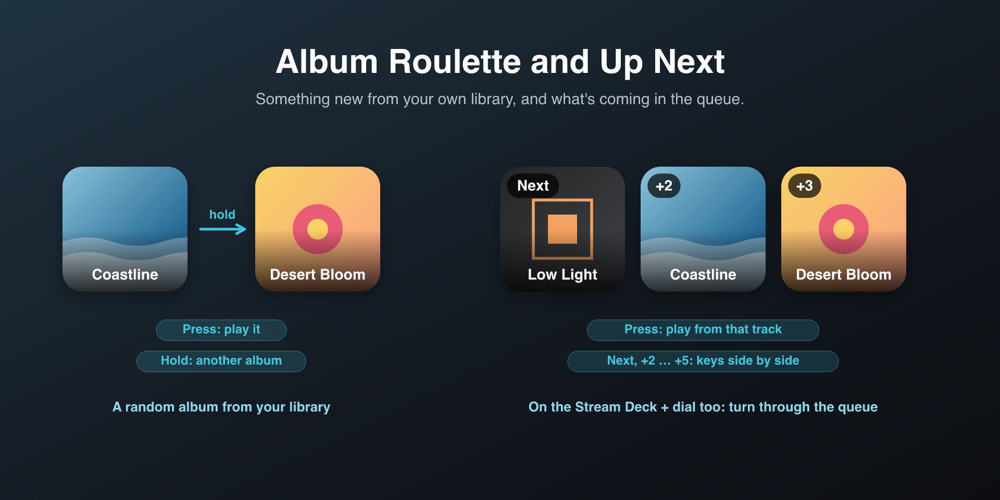

The key shows **a random album from your library**, with its cover.

- **Press:** play it (or add it next, or queue it: the **Press** setting).
- **Press and hold:** show another random album. Hold until you see one you like.

It keeps the album it shows until you hold it again, also after a restart. 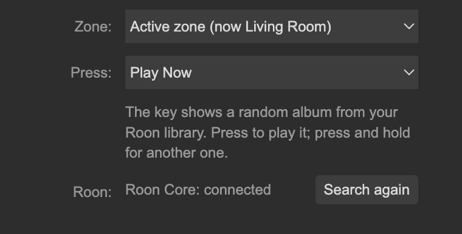

---

## Up Next

An **Up Next** key shows a track coming up in the zone's queue, with its cover and a badge: **Next**, **+2**, **+3**… up to **+5**.

- **Press:** play from that track on (the tracks before it are skipped).
- Put three keys side by side, set to the next track, +2 and +3, to see what's coming.

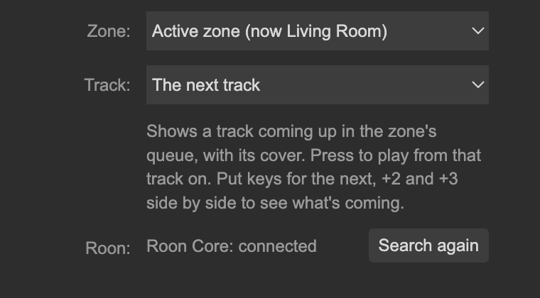

When the zone is stopped, the key says **Not playing**; at the end of the queue, **End of queue**. The [dial](#roon-dial-stream-deck-) has an Up Next mode too.

---

## Sleep Timer

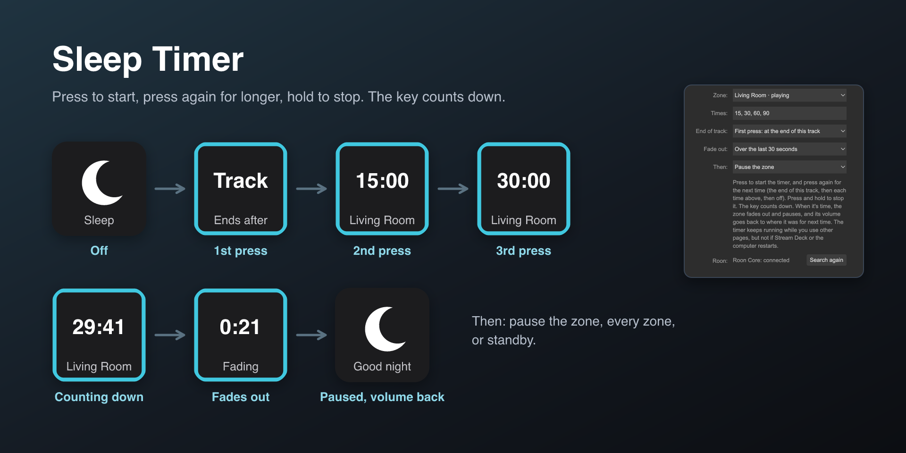

- **First press:** stop at the **end of this track** (if you keep that option on).
- **Each further press:** the next time (15, 30, 60, 90 minutes, or the times you set), then **off**.
- **Press and hold:** stop the timer.

The key counts down (**29:41**) with a ring around it. When the time is up, the zone **fades out**, **pauses** (or every zone pauses, or the audio devices go into standby), and the **volume goes back** to where it was for next time. The key says **Good night**.

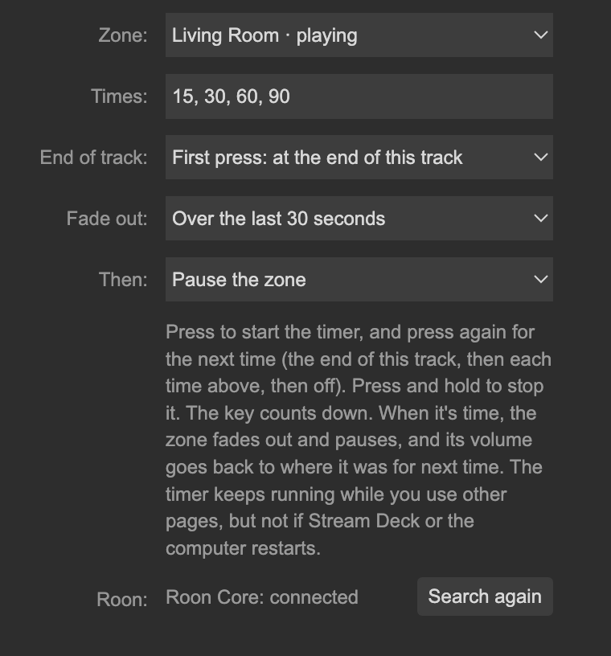

| Setting | What it does |
|---|---|
| **Zone** | The zone it puts to sleep. |
| **Times** | The minutes a press steps through, separated by commas: `15, 30, 60, 90` by default. `10, 20, 45` works too. |
| **End of track** | **First press: at the end of this track**, or **Times only**. |
| **Fade out** | **No fade**, or over the last **30 seconds**, **2 minutes** or **5 minutes**. |
| **Then** | **Pause the zone**, **Pause every zone**, or **Pause, and standby the zone's audio devices**. |

The timer keeps running while you use other Stream Deck pages or profiles. It doesn't survive Stream Deck or the computer restarting.

---

## Now Playing

The album art of what the zone is playing, with a progress bar and a pause sign when paused (or the title and artist, if you prefer).

| Setting | What it does |
|---|---|
| **Press** | **Play / Pause**, **Next track**, or **Nothing**. |
| **Show** | **Album art** or **Title and artist**. |
| **Time** | **None**, **Time played**, **Time left** or **Track length**, in the corner. |
| **Size** | **One key**, or **one big cover over several keys** (below). |

### One big cover over several keys

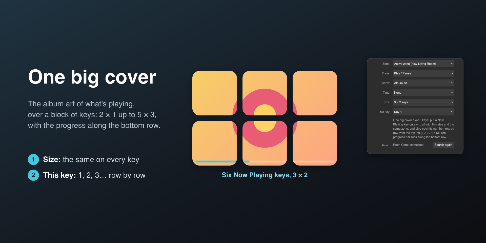

Spread the album art over a block of keys: 2 or 3 keys across, or 2 × 2, 3 × 2, 4 × 2, 3 × 3, 4 × 3 or 5 × 3 (a Stream Deck XL is 8 × 4).

1. Put a **Now Playing** key on each key of the block.
2. Give them all the same **Size** and the same **Zone**.
3. Give each its number in **This key**: 1, 2, 3… row by row from the top left. The settings page shows the numbering for the size you chose.

The progress bar runs along the bottom row. 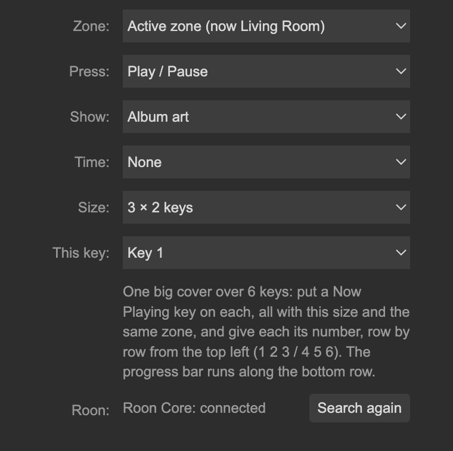

---

## Transport

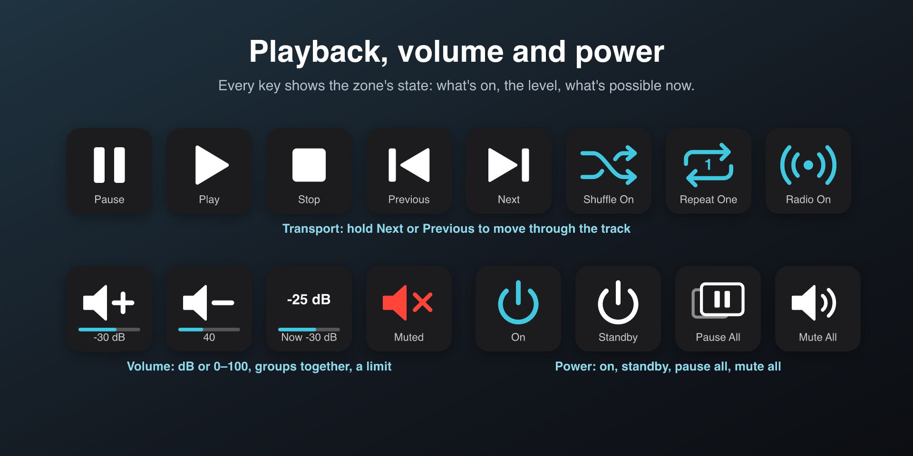

One key for **Play / Pause**, **Play**, **Pause**, **Stop**, **Next**, **Previous**, **Shuffle on / off**, **Repeat: off, all, one** or **Roon Radio on / off**. The key shows the zone's state (playing, shuffle on, repeat one…) and dims when Roon says it isn't possible now (nothing to skip to, say).

**Hold Next or Previous** to move through the track instead of skipping: 10 seconds at a time, then faster.

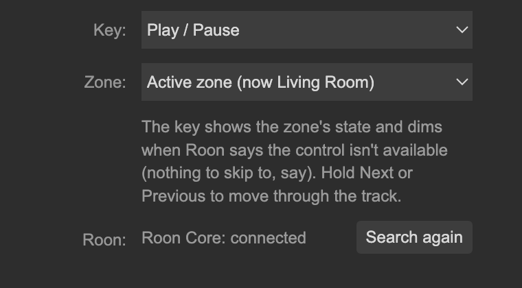

---

## Volume

| Key | What it does |
|---|---|
| **Volume up / down** | One step per press, as Roon steps that zone (e.g. 0.5 dB or 1). **Hold to keep going**, faster after a moment. |
| **Set to a level** | Jump to a level (**Level**: `-25` for dB, `40` for 0–100). The key shows the level it sets, lit when the zone is there. |
| **Mute / unmute** | Shows the level, or Muted. |

| Setting | What it does |
|---|---|
| **Change** | **The zone and every zone grouped with it** (each moves by its own step, so their balance stays), or **Only the zone chosen above**. |
| **Limit** | Optional: never above this level, so a key can't make it too loud. The key says **Limit** when it's reached. |

The key shows the level (dB or 0–100) with a bar. Devices with fixed volume show **Fixed**; amplifiers Roon controls with only + and − (by infrared, say) get + and − without a level. 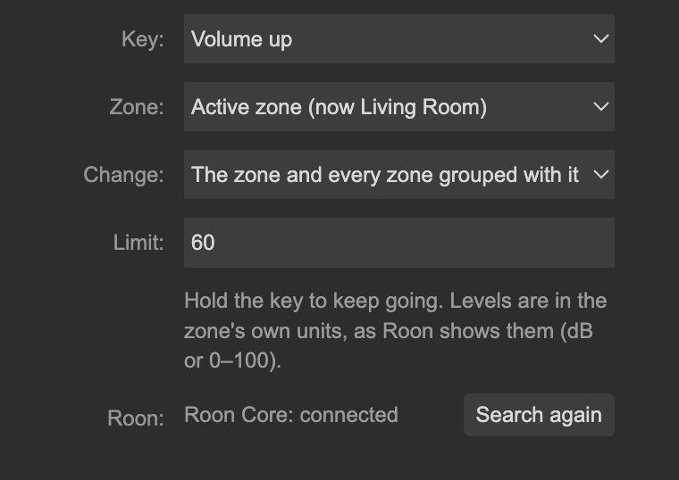

---

## Zone

| Key | What it does |
|---|---|
| **Switch the active zone** | Shows the active zone; **each press moves to the next zone**. Tick the zones to switch between (none ticked: every zone). |
| **Make this zone active** | One key per zone, side by side: press one to make it the active zone. The active one has a ring. |

Every key set to **Active zone** follows. 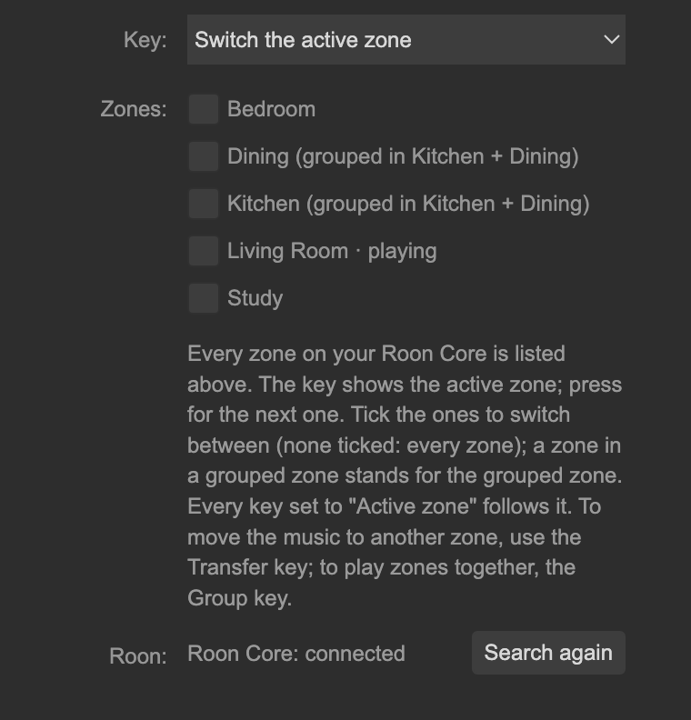

---

## Transfer

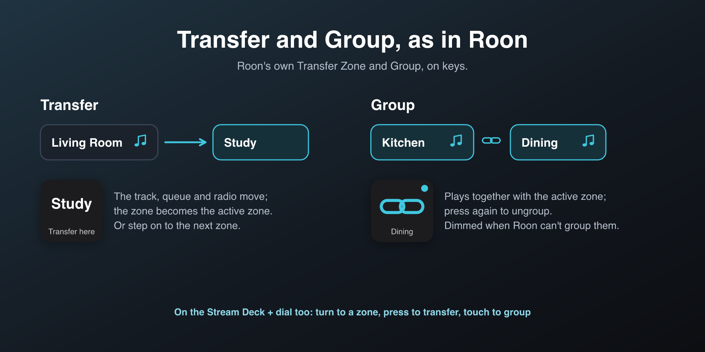

Roon's **Transfer Zone**: what's playing (the track, the queue and Roon Radio) moves to another zone.

| Key | What it does |
|---|---|
| **Transfer to this zone** | Press to move the music here; this zone becomes the active zone and has a ring. With nothing playing, it just becomes the active zone. |
| **Transfer to the next zone** | Shows the active zone; each press moves the music on to the next zone (tick the zones to step between). |

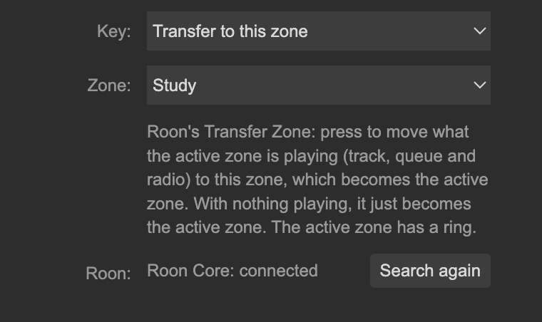

## Group

Roon's **Group**: press to group this key's zone with the active zone so they play the same music in sync; press again to **ungroup** it. The key is lit while grouped, and dimmed when Roon can't group the two (only zones of the same kind can be grouped). 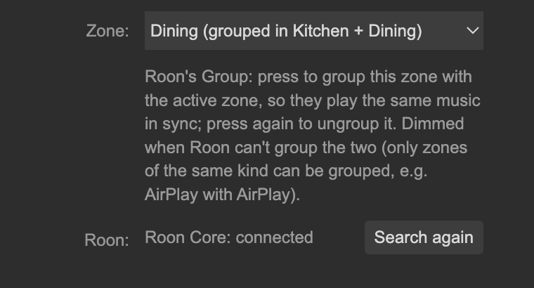

---

## Power

| Key | What it does |
|---|---|
| **On / standby** | Switches the zone's amplifier or DAC **on** (and to the right input) or into **standby**. |
| **Pause every zone** | Pauses the whole house. |
| **Mute / unmute every zone** | Press again to unmute. |

**On / standby works only with audio devices Roon can control.** In Roon: **Settings → Audio →** the device's settings (**Device Setup**) → **Standby** and **Convenience switch**. Many network speakers (Chromecast, Nest, AirPlay speakers) don't offer them; the key then says **No control**. 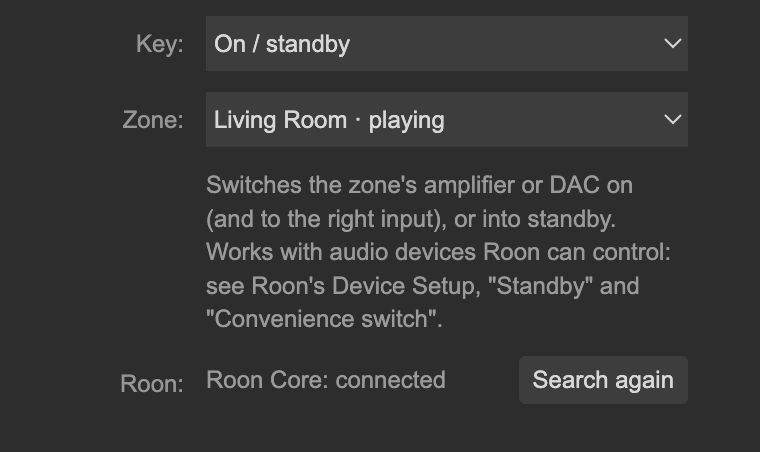

---

## Roon Dial (Stream Deck +)

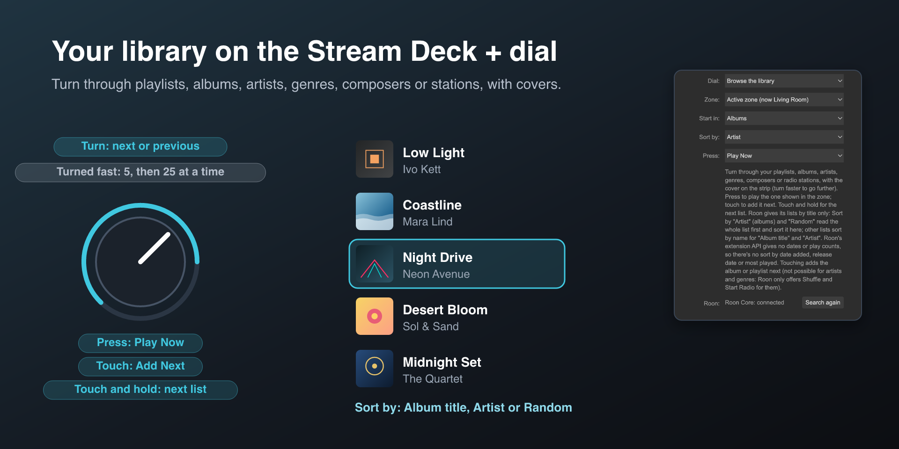

Put **Roon Dial** on a Stream Deck + dial and choose what it does. The touch strip above it shows the cover, the title and a bar.

| Dial | Turn | Press | Touch | Touch and hold |
|---|---|---|---|---|
| **Volume** | Volume (1, 2 or 5 steps per click; optional limit) | Mute | Play / Pause | |
| **Move through the track** | Shows where it will jump; Roon goes there when you stop turning (5, 10, 30 or 60 seconds per click) | Play / Pause | Next track | Previous track |
| **Previous / next track** | One track per click | Play / Pause | Shuffle on / off | Step through repeat |
| **Pick the active zone** | Turn through your zones | Make it the active zone | Same as press | Back to the active zone |
| **Transfer the music to a zone** | Turn through your zones | Transfer the music there | Group / ungroup it with the active zone | Back to the active zone |
| **Browse the library** | Turn through playlists, albums, artists, genres, composers or stations; faster turns go 5, then 25 at a time | Play Now (or Shuffle, Queue, Start Radio: **Press**) | Add Next | Next list (Playlists → Albums → Artists → Genres → Composers → Internet radio) |
| **Up next (the queue)** | Turn through the tracks coming up | Play from that track | Next track | Back to the next track |

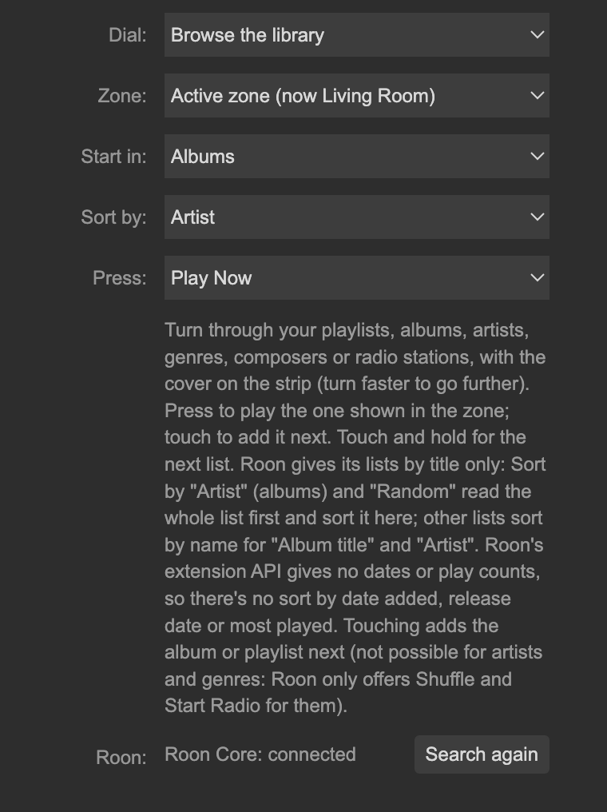

**Browse the library: Sort by** works like Roon's own menu: **Album title** (Roon's order), **Artist** (albums by artist, then title) or **Random**. Artist and Random read the whole list once and sort it; even thousands of albums take a moment only the first time. Roon's other sorts (date added, release date, most played) aren't possible: see below.

---

## What Roon allows, and what it doesn't

Remote for Roon uses only Roon's **official extension API**, so a Roon update doesn't break it. That API is narrower than Roon's own apps:

- **Actions per kind of music** (checked on a real Roon Core): playlists have **Play Now, Shuffle, Add Next, Queue, Start Radio**; albums have the same without **Shuffle** (the plugin turns shuffle on and plays); artists, genres and composers have only **Shuffle** and **Start Radio** (Play Now plays them shuffled; Add Next and Queue say **Not possible**).
- **Sorting:** the API gives each list in one order, by title, with no dates or play counts. So the dial can sort by album title, artist or at random, but not by date added, release date or most played.
- **Not in the API at all:** hearts and favourites, adding to the library, editing playlists or the queue, Roon's DSP and EQ settings, lyrics and the signal path. Some free plugins reach these through Roon's private protocol, which a Roon update can break; Remote for Roon doesn't.

---

## Ideas: pages that work well

- **A room page (any Stream Deck):** a Zone key, Now Playing, Play / Pause, Previous, Next, Volume down, Volume up, Mute, an Up Next key, and a Sleep Timer. Every key follows the active zone, so one page works for every room.
- **A favourites page:** a wall of Play keys with your albums and playlists, an Album Roulette key, and a Scene or two.
- **A house page:** one "Make this zone active" key per room, Transfer keys, Group keys, Pause every zone and Mute every zone.
- **Stream Deck +:** dial 1 Volume, dial 2 Browse the library (Albums, Sort by Artist), dial 3 Up next, dial 4 Pick the active zone; Scenes on the keys above.
- **Stream Deck XL:** a 4 × 3 big cover on the left, controls on the right.

---

## Messages on the keys

| Message | Meaning |
|---|---|
| **Enable in Roon** | Roon hasn't enabled the extension yet: Settings → Extensions → Enable. |
| **Connecting** / **No Core** | Looking for your Roon Core. If it stays, see [Troubleshooting](#troubleshooting). |
| **Core off** | The Roon Core stopped answering. Keys come back on their own. |
| **Zone off** | The key's zone isn't available now (its device is off, or disabled in Roon). |
| **No zones** | Roon has no zone enabled (Settings → Audio). |
| **Pick a zone** / **Pick music** | The key needs a zone or something to play: choose it in its settings. |
| **Not possible** | Roon can't do that here (Queue on an artist, standby on a device without it, a fixed-volume device). |
| **Not found** | The chosen music isn't in the library any more (renamed or removed): choose it again. |
| **Can't play** | Roon refused to play it. |
| **Fixed** | The zone's volume is fixed. |
| **Limit** | The volume key's limit is reached. |
| **No control** | Power: Roon can't switch this device (see [Power](#power)). |
| **Can't group** | Roon can't group these two zones. |
| **Not now** | Not possible at this moment (nothing to skip to, say). |

---

## Troubleshooting

- **The keys say "Enable in Roon":** in Roon, open Settings → Extensions and click Enable next to "Remote for Roon (Stream Deck)".
- **"No Core" or "Connecting" for a long time:** check that Roon (or Roon Server) is running and on the same network as this computer; click **Search again** in a key's settings, or type the Core's IP address in **Address** and click **Add**. On a Mac, check System Settings → Privacy & Security → Local Network → Stream Deck is on.
- **A zone is missing from the menus:** Roon only lists audio devices that are enabled in Settings → Audio.
- **Power says "No control":** the device has no standby or convenience switch in Roon's Device Setup.
- **Group is dimmed:** Roon can't group those two kinds of device.
- **The Sleep Timer stopped:** it doesn't survive Stream Deck or the computer restarting; start it again.
- **The menus in a key's settings are empty:** make sure the Roon Core is connected (the bottom of the settings says "connected"), then close and reopen the settings.

Still stuck? [Open a bug report](../../../issues/new?template=bug_report.yml) and attach the latest log from:

- **macOS:** `~/Library/Application Support/com.elgato.StreamDeck/Plugins/com.johnlee.roonremote.sdPlugin/logs/`
- **Windows:** `%APPDATA%\Elgato\StreamDeck\Plugins\com.johnlee.roonremote.sdPlugin\logs\`

The log never includes Roon's token.

---

Roon is a trademark of Roon Labs LLC. Remote for Roon is not affiliated with, sponsored by, or endorsed by Roon Labs LLC. Other names are trademarks of their respective owners.
